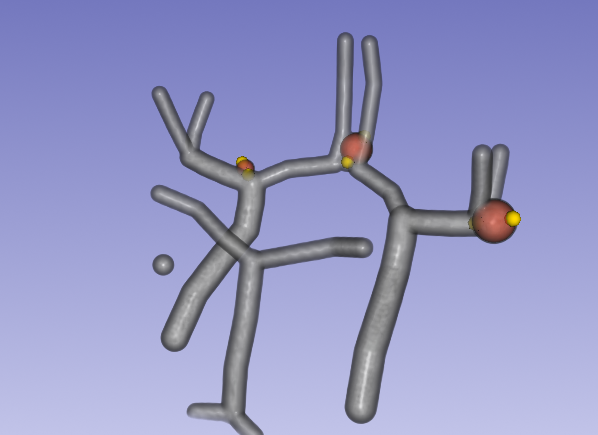

# Sphere Annotation

> Part of the original Inria GitLab project at
> [gitlab.inria.fr/yassis/slicer-sphere-annotation](https://gitlab.inria.fr/yassis/slicer-sphere-annotation),
> developed at the [Loria](https://www.loria.fr/) lab.

A [3D Slicer](https://www.slicer.org/) extension for labelling any ball-shaped object in a 3D
volume — aneurysms, nodules, lesions, cells — with spheres.

**Place two points; get a sphere.** The points sit at opposite ends of a diameter, and the
sphere follows either one as you drag it. A location and a size in two clicks, without
segmenting anything.


## Install

Requires **3D Slicer 5.12 or later**. Nothing else: Slicer supplies everything the module uses.

```bash
git clone https://github.com/youssefassis/slicer-weak-annotation.git
```

In Slicer, open *Edit → Application Settings → Modules*, add the inner `SphereAnnotation/`
directory (the one containing `SphereAnnotation.py`) to **Additional module paths**, and
restart. The module appears as **Sphere Annotation**, under *Annotation*.

## Quick start

1. **Volume → Load** a volume file, or pick one already open (a DICOM series, say) in the
   selector beside it. Then drag **Threshold** until what you are labelling stands out.
2. **Annotations → Create**, and click one edge of the object. Nothing is drawn yet — one
   point is half a sphere.
3. **Create** again, and click the opposite edge. The sphere appears.
4. Drag either point, in the 3D view or any slice view, until the sphere fits.
5. Repeat for each object, then **Save**. Your annotation is the markups node.



No data to try it on? A synthetic sample case ships in [`data/`](data/README.md).

## Features

- Any volume Slicer opens — NRRD, NIfTI, MetaImage, DICOM via Slicer's DICOM module.
- Any number of spheres per volume, adjusted by dragging in 3D or on the slices.
- Colour, opacity and visibility of the spheres.
- Load two annotations of the same volume to compare them side by side.
- Saved as standard Slicer markups (`.mrk.json` or `.fcsv`), readable by
  [any script](docs/annotation-format.md#reading-an-annotation-elsewhere).
- Leaves the rest of your scene alone, on opening and on **Clean**.

## Documentation

- [User guide](docs/user-guide.md) — every control, and troubleshooting.
- [Annotation format](docs/annotation-format.md) — how points become spheres, for reading
  the files elsewhere.
- [Development](docs/development.md) — running the tests and contributing.

## Citation

If you find this repository useful for your work, please consider citing our paper:

```
Assis et al. Aneurysm Pose Estimation with Deep Learning. In: International Conference on
Medical Image Computing and Computer-Assisted Intervention (MICCAI), Springer, 2023.
```

## License

Copyright 2023-2026 Youssef Assis. Licensed under [Apache 2.0](LICENSE).
