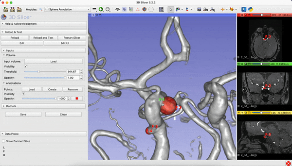

# Slicer Aneurysm Annotation Module
The Slicer Aneurysm Annotation Module is a software tool that simplifies the process of annotating aneurysms using spheres in 3D. This module provides an intuitive interface that makes it easy for users to annotate aneurysms and save their annotations for later use.

# Main Module View


# Getting Started
## Prerequisites
-  [3D Slicer](https://www.makeareadme.com/) version 4.11 or later
-  Annotation Module

## Installation
To use the  Annotation module, you will need to have 3D Slicer version 4.11 or later installed on your machine. You can download the latest version of 3D Slicer from the [official website](https://download.slicer.org/).

To install the Aneurysm Annotation module, follow these steps:


1. Download the module from the official repository:
    ```
    git clone https://gitlab.inria.fr/yassis/slicer-sphere-annotation.git
    ```
2. Open 3D Slicer.
3. Go to the Application Settings (in the "Edit" menu).
4. Go to the "Module" tab.
5. Add the module path in the "Additional module paths".
6. Press OK. Slicer will need to be restarted.

## Usage
To use the Aneurysm Annotation module, follow these steps:

- Open the Aneurysm Annotation module from the Extension Manager (under the "View" menu) by searching for "Aneurysm Annotation".
- Load the volume into Slicer. The volume will automatically appear in the 3D view. You can adjust its visibility, thresholding, and opacity.
- Load, create, or delete the points that define the spheres.
- The spheres will automatically be drawn in the 3D view. Each pair of points defines a sphere. The size and position of the spheres can be easily adjusted by modifying the position of the points.
- Adjust the size, position, and color of the sphere as needed.
- After annotating, save the annotation using the "Save" button.
- To load a previously saved annotation, click the "Load" button and select the annotation file.

## Features
The Slicer Aneurysm Annotation Module includes the following features:
- Intuitive user interface for easy annotation of aneurysms.
- Ability to adjust the size, position, and color of spheres to highlight the location of the aneurysm.
- Ability to save and load annotations for later use.
- Ability to compare multiple annotations at the same time.


## Contact
If you have any questions or feedback about this module, please contact me:
- Youssef Assis (youssef.assis@loria.fr)

## License
For open source projects, say how it is licensed.
