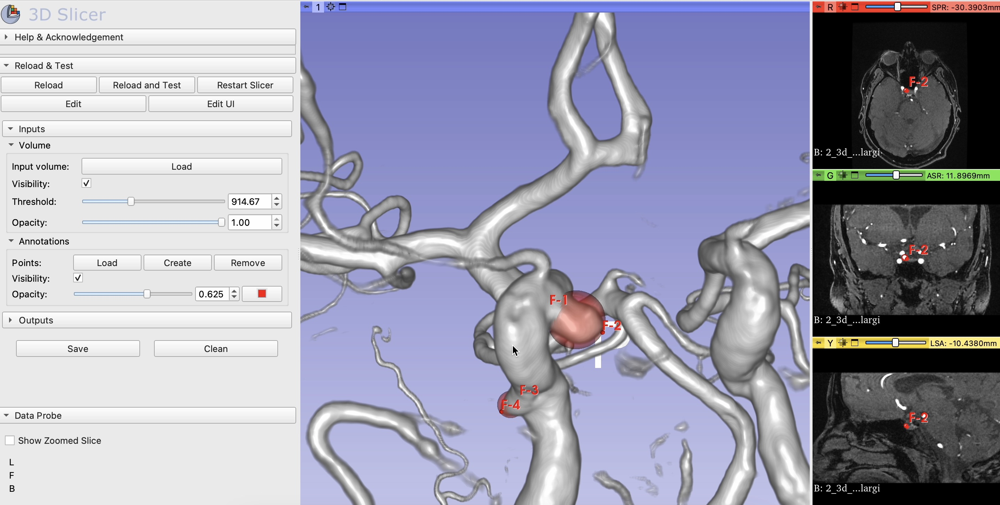
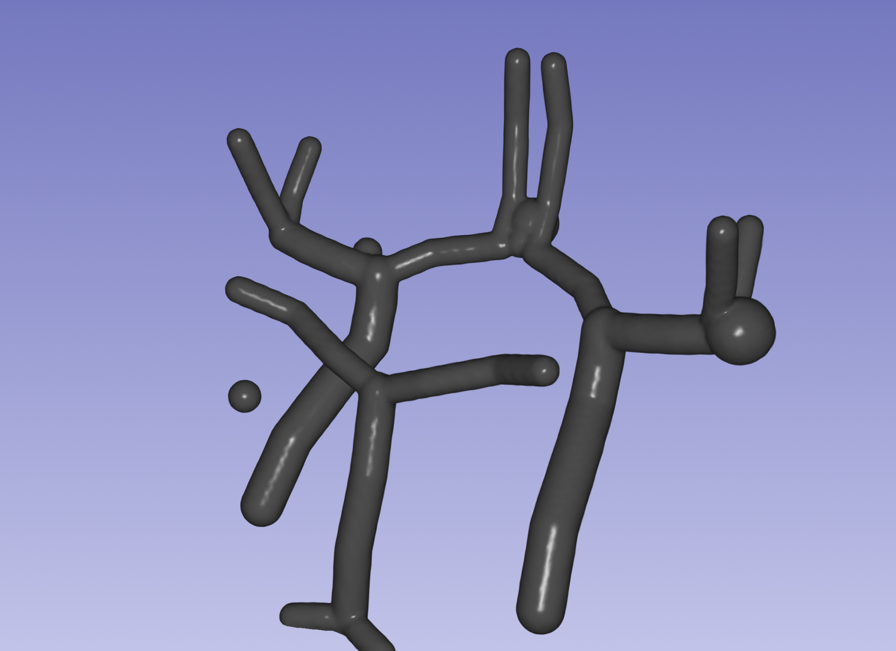
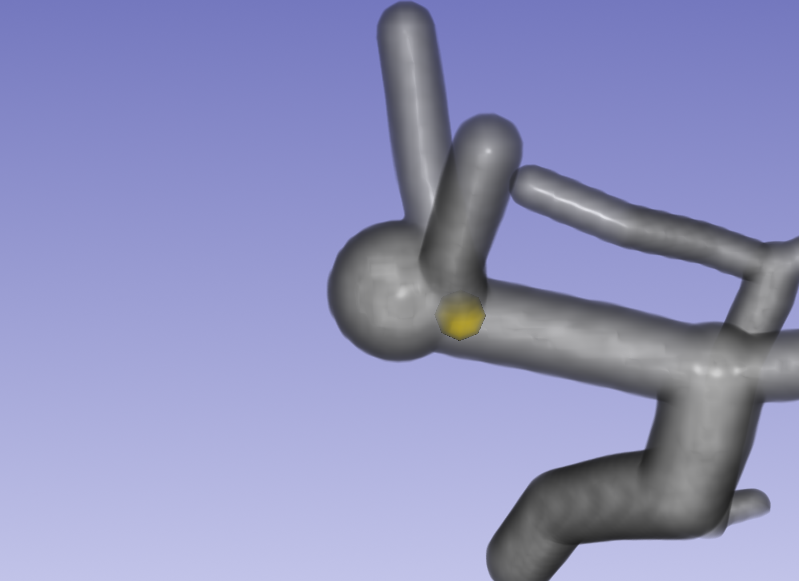
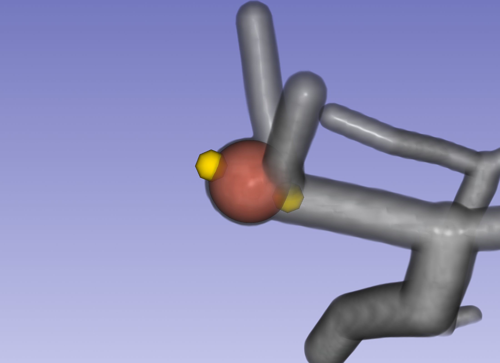
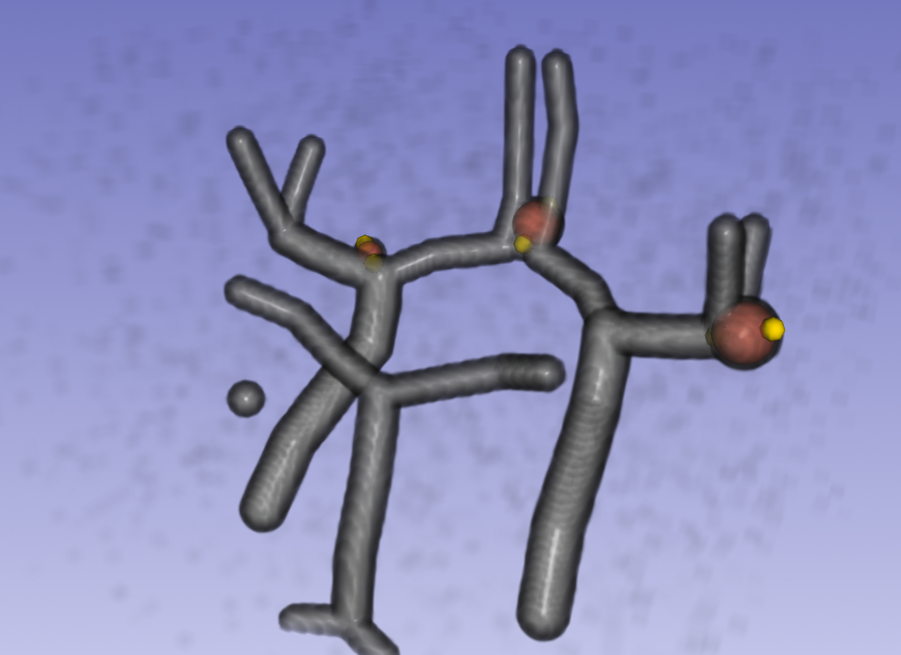
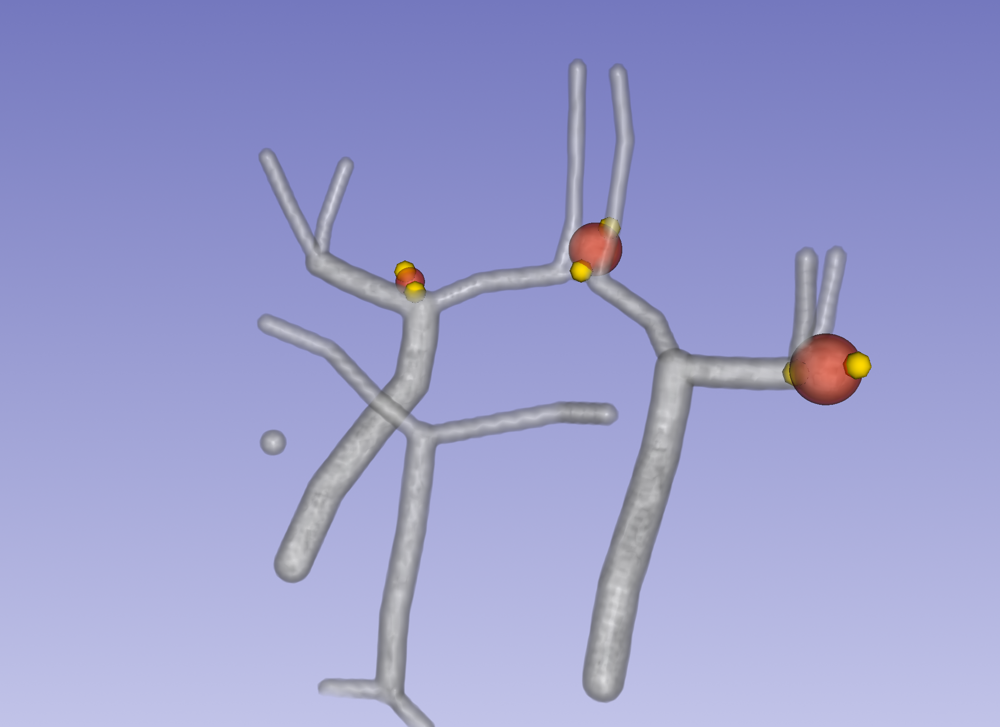

# User guide

The module appears in Slicer as **Sphere Annotation**, under the *Annotation* category. It works on
any ball-shaped object; the figures below use the bundled synthetic sample case.

You place **two points per sphere**, at opposite ends of a diameter. The sphere appears
between them and follows either point as you drag it. That is the whole interaction, and the
whole [file format](annotation-format.md).

## Your first sphere

1. **Volume → Load**, and pick a volume file — or choose one that is already open in the
   selector next to it.
2. Drag **Threshold** until the structures you are labelling stand out.

   

3. **Annotations → Create**, then click one edge of the object.
4. **Create** again, then click the opposite edge. The sphere appears.
5. Drag either point until the sphere covers the object.
6. **Save**.

Nothing is drawn after step 3, and that is correct — one point does not define a sphere, and
the module will not guess the second.

 

*One point, then two.* No volume to hand? A synthetic sample case ships with the module — see
[`data/`](../data/README.md), which is what these figures use.

Getting a sphere right usually means nudging both points across two or three slice views. That
is why they are ordinary Slicer markups rather than anything custom: every tool you already
know works on them.

## Before anything else

**Opening this module does not touch what you already have loaded**, and neither does
**Clean**. Earlier versions cleared the entire scene on open — if you are used to working
around that, you no longer need to.

## Volume

| control | what it does |
| --- | --- |
| **Selector** | Picks a volume that is already in the scene — one you loaded elsewhere, or a DICOM series loaded through Slicer's DICOM module — and sets up its 3D rendering. A picked volume stays yours: **Clean** and picking another one leave it in the scene. |
| **Load** | Opens a file dialog for a volume file (NRRD, NIfTI, MetaImage, Analyze, TIFF, or anything else Slicer reads, under *All files*) and sets up its 3D rendering. Replaces the volume *this module* loaded last time; leaves everything else alone. |
| **Visibility** | Shows or hides the 3D rendering. Not the slice views — those are Slicer's own. |
| **Threshold** | Everything below it is transparent, so this is what hides the background around what you are labelling. Starts a third of the way up the volume's intensity range; the slider's ends are that range. |
| **Opacity** | How solid everything above the threshold appears. |

Both sliders do nothing until a volume is loaded or picked.

 

*A low threshold, then a high one.* Low leaves the background haze in the way. High clears it
but thins the vessels, and pushed far enough it starts eating the smaller branches. Somewhere
between is a vessel tree you can aim at.

## Annotations

| control | what it does |
| --- | --- |
| **Load** | Opens a markups file (`.mrk.json` or `.fcsv`) and draws its points as spheres. Loading a second file **adds** it rather than replacing the first — that is how you compare two annotations of the same volume. Picking a file that is already open asks first, since two identical sets of spheres drawn through each other cannot be told apart. |
| **Create** | Enters place mode for one point. Click in any view to place it. |
| **Remove** | Deletes the last point placed. |
| **Visibility** | Shows or hides the spheres. Ticks itself when the first sphere appears. |
| **Opacity** | How solid the spheres are, from transparent to fully opaque. |
| colour swatch | The colour of every sphere. There is one colour for all of them. |

### Removing

**Remove** takes off the **last point placed**, so clicking it twice removes the last sphere.
It cannot remove a sphere from the middle of the list.

If you need to, you can delete any point from Slicer's **Markups** module — but the spheres
are defined by *consecutive pairs*, so deleting a single interior point re-pairs every sphere
after it and the rest of the annotation will visibly change. Deleting **two adjacent points
that form a pair** is safe.

## Save and Clean

| button | what it does |
| --- | --- |
| **Save** | Opens Slicer's Save Data dialog. Your annotation is the markups node — save that. Slicer 5 writes `.mrk.json` by default; `.fcsv` is offered for the legacy format. |
| **Clean** | Removes the volume, the points and the spheres **this module** put in the scene. Anything else stays — including a volume you picked in the selector. |

**Clean discards unsaved points without asking.** Save first.

## If something looks wrong

| what you see | why |
| --- | --- |
| A sphere is hidden inside the object | At full volume opacity the object hides a sphere that fits it exactly. Turn **Volume → Opacity** down to see one against the other. |
| A sphere you expected is missing | An odd number of points — one sphere is half-placed. Place its second point, or **Remove** the stray one. |
| The spheres shifted after you deleted a point | You deleted an interior point, which re-pairs everything after it. Undo, and delete whole pairs instead. |
| A sphere has no size | Its two points are on top of each other. Drag one out. |
| The spheres vanished after a module reload | Reloading removes the drawn spheres but **keeps your points**. The module loses track of them, so **Create** starts a fresh list. Save before reloading if you want one file. |
| Nothing happens when you click **Create** | Place mode ends after one point. Click **Create** again for the next one. |

Closing the scene from the File menu takes everything with it, as it does for any module.

The spheres are also drawn as outlines on the 2D slice views, which is usually the easier
place to judge whether one actually covers the object.
